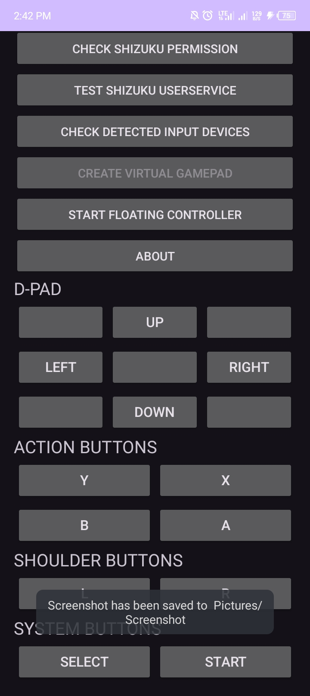
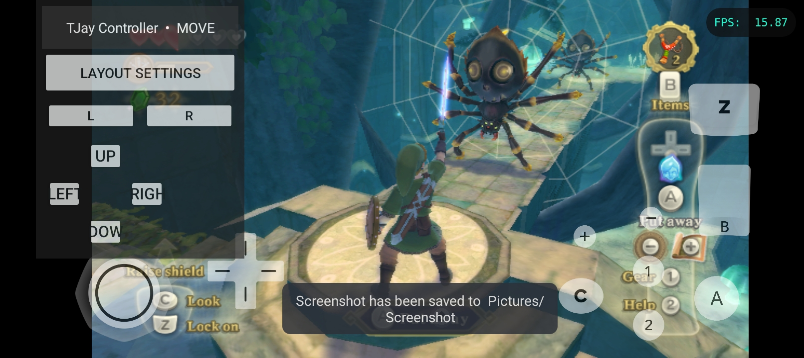
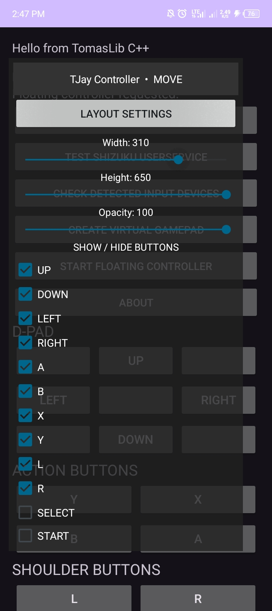

# TJay Input Bridge
> A virtual gamepad bridge for Android games and emulators.

---

## 📱 About

TJay Input Bridge is an Android companion application that creates a virtual gamepad and provides floating on-screen controls for interacting with supported games and emulators.

Powered by Shizuku, it allows your Android device to provide virtual gamepad input without requiring a physical controller.

## ✨ Features

- 🎮 Virtual Gamepad
- 🕹️ Floating On-Screen Controls
- 🎯 D-pad and A/B/X/Y Buttons
- 🎮 L/R Shoulder Buttons
- 📐 Customizable Controller Layout
- 🎨 Adjustable Control Opacity
- 👁️ Individual Button Visibility
- 🔄 Reset Controller Layout
- ⚙️ Shizuku Integration

## 📸 Screenshots

### 🏠 Home Screen

  

🎮 Floating Controls

  

⚙️ Controller Settings

  

---

## 📥 Download

Get the latest version of TJay Input Bridge from GitHub Releases.

"⬇️ Download TJay Input Bridge" (../../releases/latest)

«Note: TJay Input Bridge is currently distributed as an APK for Android devices.»

---

## 🛠️ Built With

- Java
- C++
- Android SDK
- Android NDK
- Shizuku
- AndroidIDE-Rv2

## 📋 Requirements

- Android 7.0 (API 24) or newer.
- Shizuku installed and properly configured.
- A compatible game or emulator.
- Required permissions granted to the application.

## 🚀 Installation

1. Download the latest APK from "Releases" (../../releases).
2. Install the APK on your Android device.
3. Install and configure "Shizuku" (https://shizuku.rikka.app/).
4. Open TJay Input Bridge and grant Shizuku permission.
5. Start the virtual gamepad.
6. Enable the floating controls and open your preferred game or emulator.

## ⚠️ Compatibility

Compatibility depends on the Android version, Shizuku configuration, and the game or emulator being used.

## 📄 Copyright

© 2026 Tijani Usman. All rights reserved.

TJay Input Bridge is proprietary software. Its source code and application are not licensed for redistribution, modification, or reuse without permission from the copyright holder.

## 👨‍💻 Developer

**TJay/Tijani Usman**

GitHub: [@TJAY-DEV0](https://github.com/TJAY-DEV0)

---

⭐ If you find TJay Input Bridge useful, consider giving the project a star!